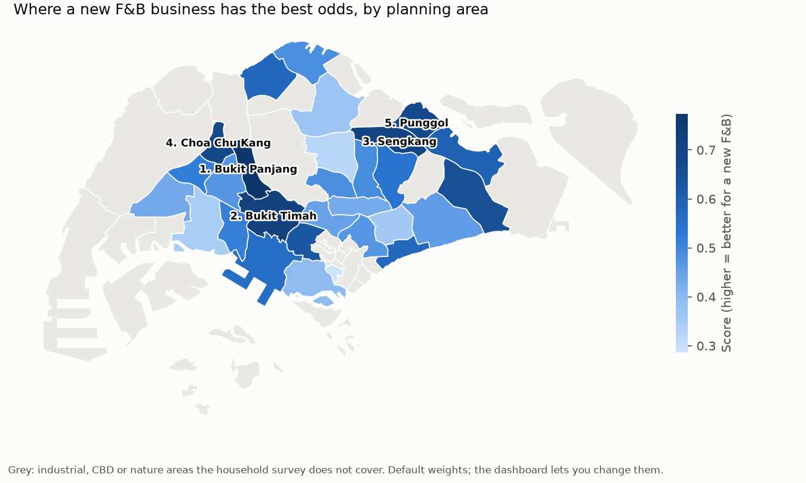
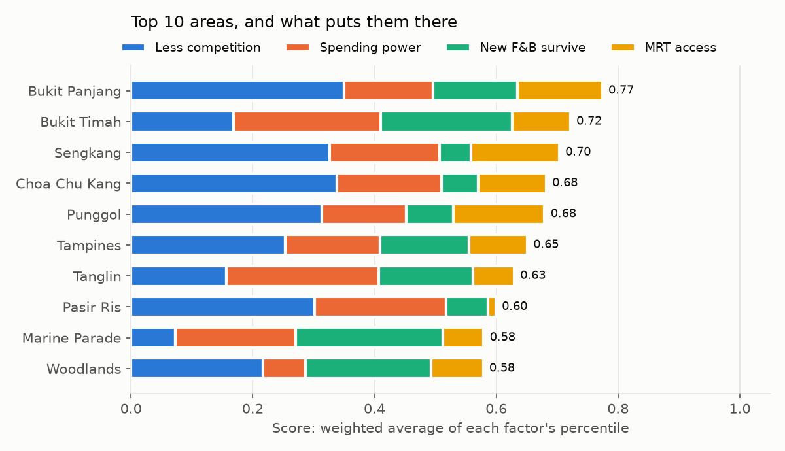

# sg-fnb-site-finder

**Where in Singapore should a new café, hawker stall or restaurant open? This ranks
the 29 residential planning areas on four things a newcomer cares about: how much
competition there is, how much residents have to spend, how often new F&B businesses
there survive, and how much passing trade the MRT brings.** All inputs are public
data. A dashboard lets you set your own weights.

Built with Python, pandas, Shapely and Streamlit. 19 tests, including the dashboard.



## What it found (ACRA register of 14 Oct 2026)

With the default weights (competition 35%, spending power 25%, survival 25%, MRT 15%):

| Rank | Area | Residents per F&B business | Median household income | MRT stations |
|---|---|---|---|---|
| 1 | Bukit Panjang | 469 | $12,722 | 11 |
| 2 | Bukit Timah | 191 | $30,469 | 6 |
| 3 | Sengkang | 438 | $13,237 | 15 |
| 4 | Choa Chu Kang | 456 | $13,104 | 8 |
| 5 | Punggol | 386 | $12,591 | 17 |

- **The north-west and north-east HDB towns are under-served.** Bukit Panjang, Choa
  Chu Kang and Sengkang each have over 430 residents for every F&B business. Geylang
  has 52 and Outram 12.
- **Bukit Timah is in the top five for the opposite reason.** It has fairly heavy
  competition, but household income is second only to Tanglin.
- **The top three don't depend on the weights.** Under 5,000 random weightings, Bukit
  Panjang is in the top five 80% of the time, Bukit Timah 73% and Sengkang 63%.
  Tampines, sixth with the default weights, makes the top five under only 13% of them.
  If your priorities differ from the defaults, those three are still the safest
  shortlist.



## How it works

| Factor | Measured as | Source |
|---|---|---|
| Less competition | residents ÷ live F&B businesses in the area | SingStat residents; ACRA register |
| Spending power | median monthly household income | SingStat household survey 2025 |
| New F&B survive | share of F&B companies registered 2019–2022 that are still live (4 to 7 years on) | ACRA register |
| Passing trade | MRT stations in the area | LTA station exits |

Each factor becomes a percentile among the 29 areas (0 = worst, 1 = best), and the
score is the weighted average. The ACRA register has no coordinates, so every
business's postcode is converted to a location with OneMap (in Singapore a postcode
is one building) and placed in a URA planning area.

The 26 areas left out (grey on the map) are the CBD, industrial estates and nature
areas, where the household survey reports no income. They hold 1.3% of residents.

## How far to trust it

**The register records where a business is *registered*, not always where it trades.**
To check, live F&B businesses per area were compared with NEA's list of licensed
eating establishments (2016, the latest published):

- The two rank areas very similarly: a Spearman correlation of **0.93 across all 53
  areas** and **0.80 across the 29 residential ones**.
- **Sembawang is the clear exception:** 2.4 times as many registrations as its outlets
  would suggest. 46% of its live F&B businesses are registered in five buildings,
  led by the Food Xchange @ Admiralty food factory (262 businesses). These are central
  kitchens and caterers, not shops, so Sembawang's competition looks worse than it is.
- The top five areas have no such factory cluster. In four of them the five busiest
  postcodes hold 7% to 12% of the businesses. In Bukit Timah they hold 21%, but these
  are food malls where outlets really trade (Beauty World Centre, Bukit Timah Shopping
  Centre, The Grandstand), and Bukit Timah has slightly fewer registrations than its
  outlet count would suggest (0.86 times).
- Punggol has 1.7 times its 2016 outlet count, which fits a town that has grown a lot
  since 2016.

**Survival hardly tells the areas apart.** 54% of the 6,562 F&B companies registered
in these areas in 2019–2022 are still live. Small areas look extreme by chance (Tengah:
6 of 8 still live, 75%), so each area's rate is pulled toward the island-wide rate by
how little data it has (beta-binomial shrinkage). After that, every area sits between
**53% and 57%**, and their 90% intervals mostly overlap. Because each factor is turned
into a percentile, that small spread still moves the score. Set survival to zero in
the dashboard if you would rather ignore it.

**Coverage.** 37,973 businesses are live or were registered since 2019 (the only ones
any factor uses). **99.6% of them were placed in a planning area.** Older closed
businesses are never looked up, which is why only 81,829 of all 99,634 F&B entities
ever registered have a location.

**"Live" means the registration is current, not that the business is profitable.**
This is a shortlist to go and look at, not a substitute for walking the street.

## Use it

```bash
pip install -r requirements.txt
streamlit run app.py        # set your own weights; the ranking and chart update
```

The dashboard reads the committed `results/`, so it runs instantly. To rebuild:

```bash
python scripts/ingest.py    # download inputs (~660 MB streamed from ACRA, ~4 MB kept)
python scripts/geocode.py   # only postcodes missing from the committed cache
python run.py               # writes results/
python scripts/charts.py    # redraws docs/*.png
pytest                      # 19 tests, no network needed
```

The postcode cache (`data/reference/postcode_locations.csv`, 15,887 postcodes, 98.4%
found) is committed. OneMap allows about one lookup a second without a key, so a cold
run would take about 4.5 hours.

## Code

| File | What it does |
|---|---|
| `sitefinder/sources.py` | reads each input; median income from SingStat's income brackets by interpolation |
| `sitefinder/geo.py` | point-in-polygon lookup of planning areas |
| `sitefinder/build.py` | one row per area; the registered-address check |
| `sitefinder/stats.py` | beta-binomial shrinkage of survival rates, with credible intervals |
| `sitefinder/score.py` | percentile scoring, ranking, and the random-weights sensitivity test |
| `tests/test_sitefinder.py` | parsing, geography, shrinkage, scoring, end to end on hand-made data |
| `tests/test_app.py` | the dashboard loads, a slider changes the ranking, all-zero weights warn |

## Outputs (`results/`)

| File | One row per |
|---|---|
| `area_metrics.csv` | planning area (all 55): residents, income, F&B counts, survival with interval, MRT, hawker centres |
| `ranking.csv` | ranked area, with each factor's percentile |
| `weight_sensitivity.csv` | ranked area: share of random weightings in the top five, median / best / worst rank |
| `registered_address_check.csv` | area: ACRA live F&B against NEA 2016 outlets |
| `summary.json` | run metadata, coverage, correlations |

Data: [ACRA Information on Corporate Entities](https://data.gov.sg/collections/2/view),
URA Master Plan 2019 planning areas, LTA MRT station exits, NEA hawker centres and
licensed eating establishments (all via [data.gov.sg](https://data.gov.sg)), SingStat
tables C020125 and C020146, under the Singapore Open Data Licence. Postcode locations
from [OneMap](https://www.onemap.gov.sg/).
